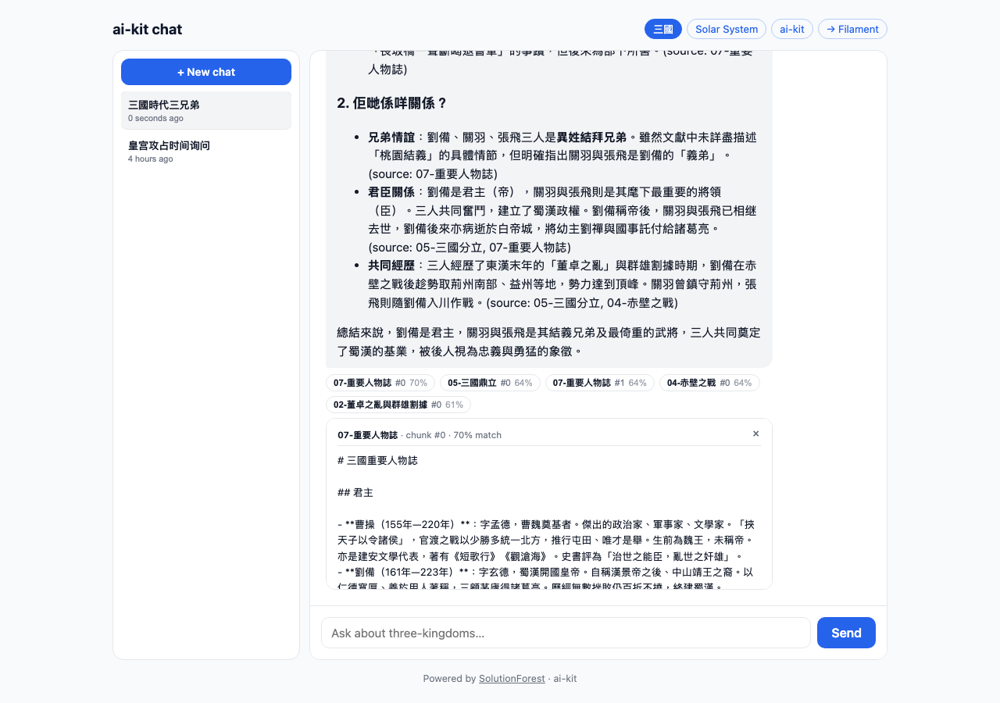

# ai-kit-ui-livewire


**The Livewire chat UI for the ai-kit suite** — a drop-in `<livewire:ai-kit.chat />` component with streaming RAG answers, markdown, source citations, and conversation history. **No build step required.**

<p align="center">
  
</p>

## Why this package?

You have a knowledge base indexed with [ai-kit-core](https://github.com/solutionforest/ai-kit-core)
and want to let users chat with it — with streaming answers and clickable source
citations — without building a chat UI from scratch or setting up a JS build
pipeline. Drop in one Livewire tag and you're done. It talks to core's
`ChatService`, so the answers match your CLI, API, and MCP surfaces exactly.

## Requirements

- PHP **8.3+**, Laravel **12 or 13**
- **Livewire 4**

> **Depends on [`solutionforest/ai-kit-core`](https://github.com/solutionforest/ai-kit-core)** — the RAG engine (ingestion, retrieval, agents). It is a hard dependency and is installed automatically with this package; you configure your knowledge bases and AI provider there. This package is only the chat UI.

## Install

```bash
composer require solutionforest/ai-kit-ui-livewire
```

Auto-discovered. Views are publishable if you want to customise them:

```bash
php artisan vendor:publish --tag=ai-kit-ui-views
```

## Usage

Drop it into any Blade view:

```blade
<livewire:ai-kit.chat collection="handbook" />
```

### Props

| Prop | Type | Default | Description |
|---|---|---|---|
| `collection` | `string` | config default | Knowledge-base slug to search |
| `agent` | `string` (class) | config agent | Agent class override (must extend `RagAgent`) |
| `placeholder` | `string` | "Ask a question…" | Input placeholder |
| `history` | `bool` | `config('ai-kit.ui.history')` (`false`) | Show the conversation-history sidebar (needs an authenticated user) |
| `citations` | `bool` | `config('ai-kit.ui.citations')` (`true`) | Show source citation chips + popups (set `false` to hide, and skip retrieval for them) |
| `streaming` | `bool` | `config('ai-kit.chat.streaming')` (`true`) | Stream the answer token-by-token over SSE (else non-streamed) |

Every boolean prop falls back to its config default when omitted, so you can set
an app-wide default in `config/ai-kit.php` and override per instance:

```blade
<livewire:ai-kit.chat collection="handbook" :citations="false" :streaming="false" />
```

```blade
<livewire:ai-kit.chat
    collection="handbook"
    :agent="\App\Ai\SupportAgent::class"
    :history="true"
    placeholder="Ask about the handbook…" />
```

## Features

- **Streaming** — token-by-token over SSE (route `ai-kit.stream`), controlled by `config('ai-kit.chat.streaming')`, with a non-streamed fallback that runs entirely inside Livewire.
- **Citations** — every answer shows source chips (document title · chunk · relevance %). Click a chip to expand the **source passage** inline with a relevance meter.
- **History** — with `:history="true"` and a signed-in user, a sidebar lists past conversations; click to reload, or start a **New chat**. Scoped to the current user.
- **Empty state** — when the collection is missing or has no embedded content, the component prompts you to create a knowledge base first.
- **Markdown** — assistant responses render GitHub-flavored markdown (HTML escaped).

<p align="center">
  
</p>

## Standalone (non-Filament) page

The component needs Livewire assets + a CSRF meta tag. Minimal host page:

```blade
<!DOCTYPE html>
<html>
<head>
    <meta name="csrf-token" content="{{ csrf_token() }}">
    @livewireStyles
</head>
<body>
    <livewire:ai-kit.chat collection="handbook" :history="true" />
    @livewireScripts
</body>
</html>
```

> Conversation **history + token logging require an authenticated user** (the conversation participant). On a public page without auth, chat still works but nothing is persisted.

## Theming

The component ships compiled, scoped CSS using CSS variables — override them in your own stylesheet:

```css
.ck-root {
    --ck-accent: #16a34a;      /* buttons, links, active states */
    --ck-user: #16a34a;        /* user bubble */
    --ck-radius: 12px;
    /* --ck-bg, --ck-fg, --ck-muted, --ck-border, --ck-assistant, --ck-user-fg */
}
```

Dark mode is handled automatically via `prefers-color-scheme`.

## How streaming works

On send, the component dispatches a browser event; JS opens an `EventSource` to `ai-kit.stream` (`StreamController`), which streams the answer and emits `delta` frames, then a `done` frame carrying the final text + conversation id. The route middleware is configurable via `config('ai-kit.ui.stream_middleware')` (default `['web']`).

## Architecture

The component is a thin view over the core `ChatService`. Both the non-streamed
path and the SSE `StreamController` delegate to
`SolutionForest\AiKit\Services\ChatService`, so RAG mode (tool/inject),
conversation persistence, citations, and token usage are handled once in core
and shared with the CLI, HTTP API, and MCP server.

## The ai-kit suite

| Package | Purpose |
| --- | --- |
| [solutionforest/ai-kit-core](https://github.com/solutionforest/ai-kit-core) | Ingestion, retrieval, agents + CLI, HTTP API, MCP |
| **solutionforest/ai-kit-ui-livewire** (this) | Livewire 4 chat component |
| [solutionforest/ai-kit-filament](https://github.com/solutionforest/ai-kit-filament) | Filament v5 admin panel |

Prefer a headless UI? The same chat is available as an HTTP API or MCP server in
`ai-kit-core` — no Livewire required.

## Continuous integration

`.github/workflows/tests.yml` runs the suite on a GitHub **release** (and manual
dispatch) — not on every push. Because this package has a local path dependency
on `ai-kit-core`, CI clones that sibling repo first, so add a repository secret
**`GH_PAT`** (a personal access token with `repo` scope) under *Settings → Secrets
and variables → Actions*. Without it the release workflow fails at the clone step.
Once `ai-kit-core` is on Packagist, drop the clone step and let Composer resolve it.

## License

MIT © [SolutionForest](https://www.solutionforest.com)
